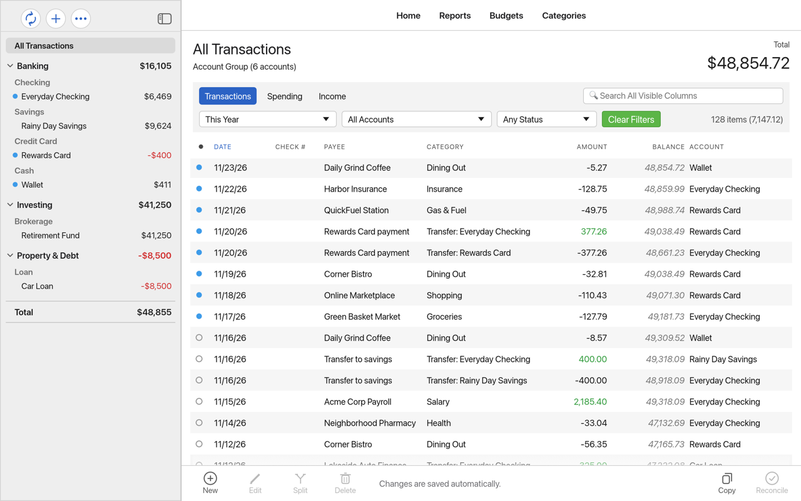
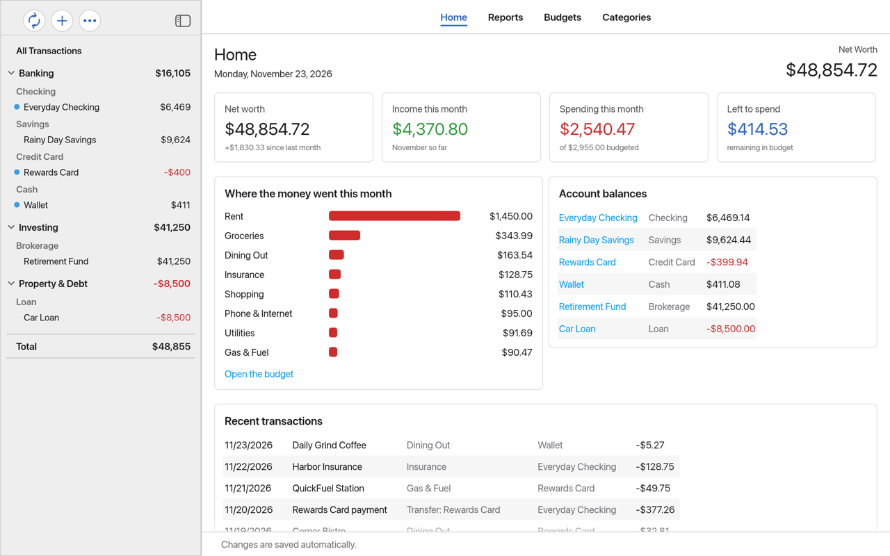
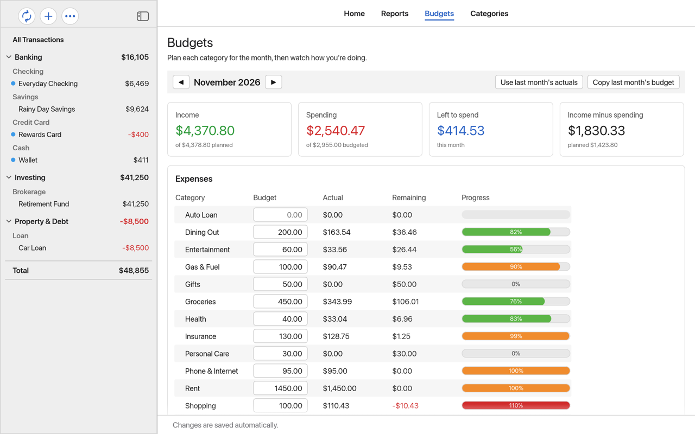
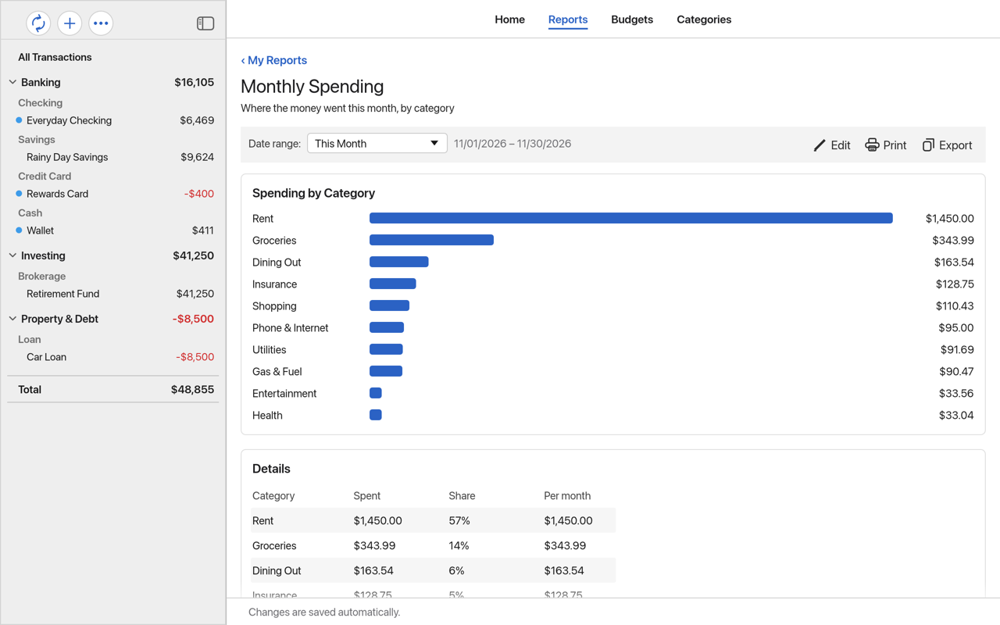
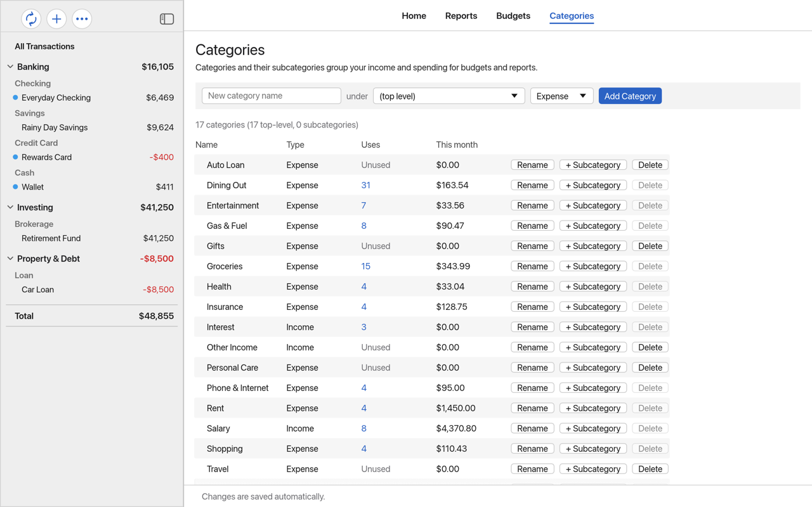

<p align="center">
  
</p>

<h1 align="center">Checken</h1>

<p align="center">
  A friendly desktop app for keeping track of your money: accounts, transactions, budgets and reports.<br>
  Runs on macOS, Windows and Linux. Your data stays on your computer.
</p>

<p align="center">
  
</p>

---

## What it does

- **Accounts in one place** — checking, savings, credit cards, cash, brokerage and loans, grouped
  in the sidebar under Banking, Investing and Property & Debt, with balances and a running total.
- **A transaction register** — enter, edit, split, copy and delete transactions; filter by date,
  account and status; search every column; mark items cleared and reconcile.
- **Categories and subcategories** — organise spending and income with a hierarchy such as
  `Auto:Fuel`; totals roll up to the parent.
- **Budgets** — plan each category for the month and see progress bars turn orange and red as
  you get close to (or over) the limit.
- **Reports** — saved reports plus standard ones (Budget, Summary, Comparison, Net Worth), with
  charts, details, printing and export.
- **Import** — Quicken CSV exports, Mint.com CSV files, and bank or brokerage QFX/OFX downloads,
  with a preview and a duplicate check before anything is added.
- **Bank connections (optional)** — download new transactions straight from your bank through
  [Plaid](https://plaid.com), using a small server you run yourself.
- **Backups** — save a backup to any file and restore from it later.

## A quick tour

| Home | Budgets |
| --- | --- |
|  |  |
| **Reports** | **Categories** |
|  |  |

- **Home** shows your net worth, this month's income and spending, what's left in the budget,
  where the money went, and recent transactions.
- **Budgets** lets you type a plan for each category, copy last month's budget, or start from
  last month's actual spending.
- **Reports** opens a chart and a detail table for any date range; *Edit* changes what a report
  shows.
- **Categories** adds, renames and nests categories, and shows how often each one is used.

## Getting started

When you first open Checken it fills itself with **sample data** so you can look around. When
you're ready to use your own money:

1. Choose **File ▸ Purge All Data…** and pick **Empty** to start fresh (see below).
2. Add your accounts with the **+** button in the sidebar (or **File ▸ New Account…**, ⇧⌘A).
3. Enter transactions with **New** at the bottom of the register (⌘N), or bring them in with
   **File ▸ Import**.

### Handy shortcuts (macOS)

| Shortcut | Action |
| --- | --- |
| ⌘1 – ⌘5 | Home, All Transactions, Reports, Budgets, Categories |
| ⌘N | New transaction |
| ⇧⌘A | New account |
| ⇧⌘I | Import a Quicken CSV file |
| ⇧⌘B | Save a backup |
| ⌘R | Update all bank accounts |
| ⌃⌘S | Show or hide the sidebar |

On Windows and Linux the same commands are in the **⋯** menu at the top of the sidebar.

## Importing from Quicken, Mint or your bank

**File ▸ Import** offers:

- **Bank or Brokerage File (QFX, OFX)…** — the file your bank's website gives you for
  "Quicken" or "Money" downloads.
- **Quicken CSV File…** — a transaction export from Quicken for Mac.
- **Mint.com File (CSV)…** — Mint's transaction export.

Checken shows a preview first: which accounts the transactions go into (new or existing), how
many are new, and which look like duplicates. Nothing changes until you confirm, and a safety
copy of your data is saved before the import. If something slipped through twice,
**File ▸ Remove Duplicate Imports…** finds and removes the repeats.

## Connecting a bank with Plaid (optional)

Checken can download transactions from your bank through Plaid. For safety, your Plaid keys and
bank access tokens live **only on a server you run** (based on Plaid's
[Quickstart](https://plaid.com/docs/quickstart/)); Checken never sees them.

1. Start your Plaid Quickstart server so it answers on `http://localhost:8000`.
2. In Checken choose **File ▸ Connect a Bank Account (Plaid)…** and sign in to your bank in the
   window that opens.
3. Pick which Checken account each bank account should fill (or let Checken create new ones).
4. Press **⟳** in the sidebar (⌘R) whenever you want the latest transactions.

**File ▸ Bank Connections (Plaid)…** lets you change the server address, see each connection,
and unlink a bank.

## Where your data is kept

| System | Folder |
| --- | --- |
| macOS | `~/Library/Application Support/Checken/` |
| Windows and Linux | `~/.checken/` (in your home folder) |

Everything is in `ledger.json` in that folder, saved automatically as you work, along with
safety copies made before imports and restores. Use **File ▸ Save a Backup…** to keep a copy
somewhere else.

### Purge All Data (for developers)

**File ▸ Purge All Data…** erases Checken's data folder and starts over, either empty or with
the sample data. You have to tick *"I understand this can't be undone"* before it will run.
Backups you saved elsewhere and banks connected on your Plaid server aren't touched. This is a
developer convenience and may be removed in a future release.

## Installing

Ready-made installers are attached to each run of the GitHub **Build** workflow
(*Actions ▸ the latest run ▸ Artifacts*), and to each release when a version tag such as
`v0.2.0` is pushed:

| System | File | How to install |
| --- | --- | --- |
| macOS (Apple silicon and Intel) | `Checken-<version>.dmg` | Open it and drag Checken into Applications. |
| Windows | `Checken-Setup-<version>.exe` | Run the installer (adds Start menu and desktop shortcuts and an uninstaller). |
| Debian / Ubuntu | `checken_<version>_amd64.deb` | `sudo apt install ./checken_<version>_amd64.deb` |
| Other Linux | `Checken-<version>-linux-x86_64.tar.gz` | Unpack it and run `Checken`. |

The app isn't signed by Apple or Microsoft yet, so the first time you open it macOS may ask you
to right-click ▸ **Open**, and Windows SmartScreen may ask you to choose **More info ▸ Run anyway**.

## Building it yourself

Checken is written in Rust with [egui](https://github.com/emilk/egui). You'll need
[Rust](https://rustup.rs) installed.

```sh
cd app
cargo run --release          # build and open Checken
cargo test                   # run the tests
```

Making installers:

```sh
cd app
./scripts/make-dmg.sh                   # macOS: dist/Checken.dmg (UNIVERSAL=1 for Apple silicon + Intel)
./scripts/make-windows-linux.sh         # Windows .exe and Linux .deb/.tar.gz, built in Docker
```

The Windows/Linux script needs Docker running (for example `colima start` on a Mac). On a small
Docker machine it builds one piece at a time; set `CARGO_BUILD_JOBS=4` on a bigger one.

To take a picture of the window without changing any data (useful for docs and checks):

```sh
./target/release/Checken --screenshot shot.png
POCKET_LEDGER_VIEW=budget ./target/release/Checken --screenshot budget.png   # home, reports, categories…
```

### Project layout

| Path | What's there |
| --- | --- |
| `app/src/` | The app: `model.rs` (accounts, transactions, saving), `app/` (screens and menus), `import.rs` and `qfx.rs` (importers), `plaid.rs` (bank connections) |
| `app/assets/icon.png` | The app icon (replace it and rebuild to change the icon) |
| `app/scripts/` | Installer scripts for macOS, Windows and Linux |
| `app/MECHANICS.md` | Detailed notes on how imports, Plaid syncing and other features behave |
| `.github/workflows/build.yml` | Builds all three installers on every push |

## A note on the name

Checken is an independent personal-finance app inspired by classic desktop money managers. It
isn't affiliated with or endorsed by Quicken Inc. or Intuit; "Quicken" and "Mint" are named only
to describe the files Checken can import.
